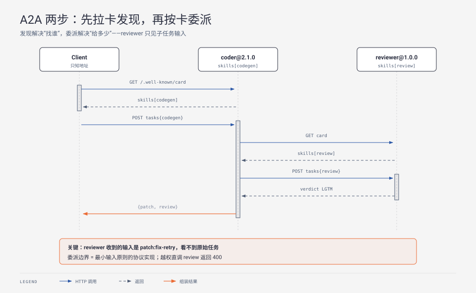

**TL;DR：** 多智能体对等协作（Agent-to-Agent，简称 A2A）的核心是把配置信息收敛进协议消息中。协作由两个原子步骤组成。第一步是发现。客户端只凭基础网络地址拉取 `/.well-known/agent-card.json` 名片，依据声明的 `skills` 构建路由表，完成主版本兼容性拦截，对未知能力实现本地零请求拒绝。第二步是委派。主智能体按名片把子任务转包给专门对等体，严格遵循最小输入原则，下游仅见子任务输入而不见完整上下文，越权直调则由服务端防御性拦截。本地测试用例证明了这套发现与隔离状态机的完整闭环。



## 一、为什么多智能体协作需要 A2A 协议

模型上下文协议（MCP）解决了大语言模型与外部工具（Tools）之间的客户端到服务器单向绑定。在工具调用模型中，主模型掌握全部上下文，每次通过 JSON-RPC 调用无状态工具并等待结果回填。

当工程系统演进到多个具备独立规划能力、私有记忆和专门工具链的智能体协作时，单中心工具调用模型开始失效。如果让主智能体把完整的对话历史、环境凭证和代码上下文全部发给每一个辅助智能体，系统会立即面临三类瓶颈。
第一，上下文窗口急剧膨胀，单次任务的 Token 开销随协作跳数呈平方级增长。
第二，敏感信息无法隔离，具有联网搜索权限的辅助智能体可能直接泄露主智能体内存中的鉴权密钥。
第三，静态拓扑极其脆弱，任何智能体服务的版本升级或能力增减，都需要同步修改所有调用方的静态配置文件。

A2A 协议借鉴了 Web 的去中心化设计思想。对等智能体之间不依赖统一注册中心强行绑定，而是将能力契约（Agent Card）与任务委派（Task Delegation）标准化。

## 二、智能体名片与动态发现合同

在 A2A 体系中，每个智能体服务在根路径提供静态元数据描述文件。标准路径固定为 `/.well-known/agent-card.json`。

### 1. 契约定义与字段语义

智能体名片是调用方进行路由决策的全部依据。一个标准的最小名片结构包含基础标识、语义版本、支持的技能集合以及任务接入端点。

| 字段 | 类型 | 语义约束 | 消费方行为 |
| --- | --- | --- | --- |
| `name` | `string` | 智能体唯一逻辑名称 | 用于日志追踪与拓扑识别 |
| `version` | `string` | 遵循 SemVer 规范的语义版本 | 校验主版本兼容性 |
| `skills` | `string[]` | 当前节点承诺处理的技能列表 | 构建本地能力匹配索引 |
| `endpoint` | `string` | 任务提交的 HTTP 路径 | 构造实际调用的请求目标 |

调用端在初始化阶段仅需要目标节点的 IP 与端口，即可自动完成能力协商。

```ts
interface AgentCard {
	name: string;
	version: string;
	skills: string[];
	endpoint: string;
}

async function discoverPeer(baseUrl: string): Promise<AgentCard> {
	const response = await fetch(`${baseUrl}/.well-known/agent-card.json`);
	if (!response.ok) {
		throw new Error(`Failed to fetch card from ${baseUrl}: ${response.status}`);
	}
	return (await response.json()) as AgentCard;
}
```

### 2. 发现阶段的三层防护

动态发现并不是简单的 HTTP GET 请求。为了保证分布式调用的稳健性，客户端必须在网络层之前建立防护。

第一层是未知能力本地拦截。客户端拉取所有对等体的名片后，将技能与节点建立映射。当上层请求一个未被任何节点声明的技能（例如 `videorender`）时，客户端直接在本地抛出错误，不向集群发送任何无效网络请求。

第二层是主版本断路。当客户端依赖的主版本为 `^2.0.0`，而对等体名片返回的版本为 `1.4.0` 时，系统判定底层接口可能发生破坏性变更，立刻阻止调用并打上脏节点标记。

第三层是服务端防御性校验。即使客户端由于缓存未刷新等原因发出了越权或不支持的请求，对等体在处理任务入口仍然会严格检查请求参数中的 `skill`。如果不在自身名片中，立即返回 HTTP 400 状态码，避免不可预测的代码执行。

## 三、任务委派：最小输入原则与状态组装

当智能体需要将部分工作转包给对等体时，协议要求遵守最小知识原则（Principle of Least Privilege）。

```text
用户任务: "修复重试逻辑并完成审查"
  ↓
Coder 智能体:
  [生成补丁] patch:fix-retry
  [提取子任务] skill="review", input="patch:fix-retry"
  ↓ (仅发送补丁字符串，隔离原始提示词与凭证)
Reviewer 智能体:
  [执行审查] 返回 "LGTM:patch:fix-retry"
  ↓
Coder 智能体:
  [组合最终产物] { patch, review }
  ↓
交付用户
```

### 1. 委派执行代码实现

以下为基于 Node.js 原生 HTTP 实现的智能体服务。Coder 智能体在接收到 `codegen` 任务后，自身执行代码修补，随后通过 A2A 机制向 Reviewer 智能体发起定向委派。

```js
import http from "node:http";

function createAgentServer(card, handler) {
	return http.createServer(async (req, res) => {
		const reply = (data, code = 200) => {
			res.writeHead(code, { "content-type": "application/json" });
			res.end(JSON.stringify(data));
		};

		if (req.method === "GET" && req.url === "/.well-known/agent-card.json") {
			return reply(card);
		}

		if (req.method === "POST" && req.url === "/tasks") {
			let buffer = "";
			for await (const chunk of req) buffer += chunk;
			const task = JSON.parse(buffer || "{}");

			if (!card.skills.includes(task.skill)) {
				return reply({ error: `skill not offered: ${task.skill}` }, 400);
			}

			const output = await handler(task);
			return reply(output);
		}

		return reply({ error: "not found" }, 404);
	});
}
```

### 2. 隔离性与边界验证

在委派链路中，Reviewer 智能体仅记录并处理 `patch:fix-retry`。Reviewer 从始至终无法窥探 Coder 是如何生成该补丁的，也不知道系统后续会将该补丁部署到哪个环境。

如果外部调用方绕过工作流，直接向 Coder 请求 `review` 技能，Coder 的服务端前置校验会根据名片契约直接丢弃该请求。这就确保了每个智能体的职责边界由代码强制收敛，而不是依赖提示词的软约束。

## 四、生产落地必须补齐的工程边界

在真实微服务或 Agent 基础设施中落盘 A2A 协议，以下四项机制必不可少。

### 1. 循环委派与跳数预算

分布式协作中极易出现因意图识别歧义导致的循环调用（例如 A 委派给 B，B 又委派给 A）。
工程实现必须在请求头中注入 `X-A2A-Hop-Limit` 或追踪元数据。每跨越一个智能体递减该计数器。当计数归零时强制熔断，抛出循环调用异常，防止调用栈死锁与 Token 资源耗尽。

### 2. 名片缓存与主动失效机制

客户端不能对每次请求都重新拉取一次名片。常见做法是设置 60 秒的本地 TTL 缓存。
同时，智能体在优雅停机或动态热更新时，可以通过广播 Webhook 或组播通知调用端主动剔除缓存，避免请求打到正在下线的废弃节点。

### 3. 名片防伪与双向 mTLS 鉴权

公开暴露的 `agent-card.json` 可能受到中间人篡改。生产环境中，名片必须由内部私有 CA 签名，或者整个对等网络运行在双向 mTLS 网格中。调用端在验证对等体名片时，校验公钥指纹与证书主体，确保能力声明真实可信。

## 五、验证实验与边界说明

本机制在 `experiments/a2a-card-discovery/demo.mjs` 和 `experiments/a2a-delegate-chain/chain.mjs` 中完成了闭环验证。

验证覆盖以下具体断言：
1. D1 卡即全部配置：客户端纯凭根路径完成两个不同节点的属性提取。
2. D2 按卡路由一次命中：目标任务准确派发至具备该技能的节点。
3. D3 未知技能零请求：调用未注册能力时，客户端本地拦截，网络抓包显示为 0 次发送。
4. D4 服务端兜底拦截：向不支持该能力的节点直发请求，服务端返回 HTTP 400 拒绝。
5. D5 语义版本破损拦截：主版本不一致时，客户端直接阻断连接。
6. 委派隔离性：下游节点接收到的输入字符长度与子任务参数严格匹配，证明无多余上下文泄露。

本实验验证了轻量协议的核心状态机，未包含分布式长连接会话恢复、复杂有向无环图（DAG）的并发委派调度以及跨地域网络抖动处理。

## 参考资料

- A2A Protocol 规范草案：<https://a2a-protocol.org/>
- Model Context Protocol (MCP) 规范说明：<https://modelcontextprotocol.io/>
- RFC 9562: Universally Unique IDentifiers (UUID)，版本兼容性与元数据发现规范
- 站内对照：MCP 无状态核心与协议分层，`/writing/llm-09-mcp-stateless-core`
- 架构演进：多智能体编排与共识机制，`/writing/ai-backend-12-multi-agent-orchestration-consensus`
