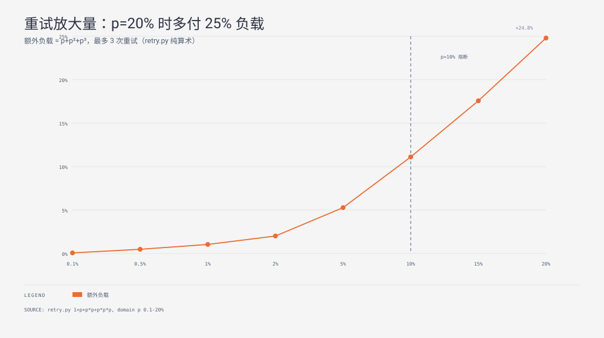

**TL;DR：** 服务韧性参数的核心必须由数学模型驱动。限流算法中，固定窗口在临界点存在 2 倍流量逃逸缺陷，在 2 毫秒内可放行 200% 的突发流量。滑动日志虽然能平滑突发，但内存开销随阈值线性膨胀。滑动窗口计数算法用 3 个数值以常数级内存将峰值压制在 1.0 倍。下游故障时的重试放大遵循等比数列求和公式 \( \sum_{i=0}^k p^i \)。在故障率达到 20% 时，客户端盲目重试会导致下游承受 1.248 倍的流量打击。工程解法是引入动态重试预算，一旦失败率越过 10% 阈值立即熔断重试，将流量倍数强制压回 1.0 倍。



## 一、限流器的临界点盲区：2 毫秒内放行 2 倍流量

限流是防止级联崩溃的第一道防线。很多线上系统虽然配置了限流，但在流量高峰依然被瞬间打穿。根因在于选用了错误的窗口状态机。

### 1. 固定窗口的边界穿透

固定窗口算法维护当前时间片与一个自增计数器。当时间跨越整秒时，计数器直接清零。
假设限流阈值为 100 请求每秒。攻击者可以在第一秒的第 999 毫秒发送 100 个请求，并在第二秒的第 1 毫秒紧接着发送 100 个请求。

```text
时间轴 (毫秒):
  [窗口 1: 0ms ~ 999ms]          [窗口 2: 1000ms ~ 1999ms]
               ↓                             ↓
          t = 999ms                     t = 1001ms
         流入 100 请求                 流入 100 请求
              │                             │
              ▼                             ▼
         [计数器 = 100]  ──清零──>      [计数器 = 100]
         (全部放行)                     (全部放行)
```

在系统看来，两个窗口内的计数都没有超标。但从物理时间的任意 1 秒滑动观察，系统在短短 2 毫秒内放行了 200 个请求，突发倍率高达 2.0 倍。底层数据库连接池与线程池直接被击穿。

### 2. 四种限流算法状态机对比

为了消除边界突刺，工业界发展出滑动日志、滑动窗口计数和令牌桶算法。它们在突发控制和空间成本上形成了明确的取舍。

| 算法 | 突发放行量（2ms 极限） | 内存空间复杂度 | 维护的状态结构 | 适用场景 |
| --- | --- | --- | --- | --- |
| 固定窗口 | 200 请求（2.00x） | \(O(1)\) | 2 个整数：`start`, `count` | 粗粒度后台批处理 |
| 滑动日志 | 100 请求（1.00x） | \(O(\text{LIMIT})\) | 列表保存窗口内所有时间戳 | 极低频高价值鉴权 |
| 滑动窗口计数 | 100 请求（1.00x） | \(O(1)\) | 3 个浮点数：`prev`, `cur`, `start` | 高并发网关核心限流 |
| 令牌桶 | 100 请求（只放容量） | \(O(1)\) | 3 个数：`rate`, `capacity`, `tokens` | 允许受控突发流量接入 |

滑动窗口计数算法结合了固定窗口的极低空间与滑动日志的高精度。它通过权重插值估算跨窗口流量：

\[
\text{estimate} = \text{count}_{\text{prev}} \times (1 - \text{elapsed}) + \text{count}_{\text{cur}}
\]

当新请求到达时，只要估算值小于阈值就放行。这一插值不仅不需要保存单条时间戳，还能精确截断跨界面的突发流量。

```python
class SlidingCounter:
    def __init__(self, limit=100, window=1.0):
        self.limit = limit
        self.window = window
        self.prev = 0
        self.cur = 0
        self.window_start = 0.0

    def allow(self, t):
        if t - self.window_start >= self.window:
            self.prev, self.cur = self.cur, 0
            self.window_start = t
        elapsed = (t - self.window_start) / self.window
        estimate = self.prev * (1.0 - elapsed) + self.cur
        if estimate < self.limit:
            self.cur += 1
            return True
        return False
```

## 二、重试风暴的级数放大数学模型

重试机制本意是抹平分布式网络偶发的瞬时抖动。但在依赖服务过载时，固定次数的重试机制是加速系统雪崩的催化剂。

### 1. 流量放大推导

设调用下游的单次请求失败概率为 \( p \)。客户端配置的最大重试次数为 \( k \)。
每一次重试仅在上一轮失败后触发，且各轮失败相互独立。那么单次业务调用向依赖方产生的平均请求总次数为：

\[
\text{Amplification}(p, k) = 1 + p + p^2 + p^3 + \dots + p^k = \sum_{i=0}^k p^i = \frac{1 - p^{k+1}}{1 - p}
\]

以微服务体系常见的 \( k = 3 \) 次重试为例：
1. 稳态健康期（\( p = 0.1\% \)）：
   \[
   1 + 0.001 + 0.000001 + 0.000000001 \approx 1.001001\times
   \]
   放大仅为千分之一，系统以极低成本换取了网络抖动的无感恢复。
2. 依赖过载期（\( p = 20\% \)）：
   \[
   1 + 0.2 + 0.04 + 0.008 = 1.248\times
   \]
   下游服务此时由于 CPU 饱和已经开始丢弃 20% 的请求。上游客户端没有退让，反而自动向已经濒死的下游多注入了 24.8% 的请求。
3. 极端崩溃期（\( p = 50\% \)）：
   放大系数达到 1.875 倍，流量翻倍直接导致熔断雪崩。

### 2. 重试预算（Retry Budget）机制

不能让单次调用的重试次数独立决定全局行为。业界（如 Finagle、gRPC）的标准解法是在客户端引入重试预算。

重试预算的核心原则是：允许重试的比例与全局请求吞吐绑定。
客户端在滑动窗口内统计正常请求总数与重试请求总数。通常配置预算上限为 10%（即重试请求量不得超过正常请求量的 10%）。

```text
当全局失败率 p <= 10%:
  重试令牌池充裕 -> 允许常规指数退避重试 (Backoff + Jitter)

当全局失败率 p > 10%:
  重试预算耗尽 -> 强制熔断重试
  所有失败调用立即向业务层返回错误，不再触发二次请求
  下游实际承载流量倍数强制归一化为 1.0x
```

```python
class RetryBudget:
    def __init__(self, max_ratio=0.10):
        self.max_ratio = max_ratio
        self.normal_count = 0
        self.retry_count = 0

    def record_attempt(self, is_retry: bool):
        if is_retry:
            self.retry_count += 1
        else:
            self.normal_count += 1

    def can_retry(self) -> bool:
        if self.normal_count == 0:
            return False
        return (self.retry_count / self.normal_count) < self.max_ratio
```

通过这一约束，当服务集群出现系统性故障时，重试会自动关闭，系统立即降级为快速失败，为下游服务的恢复争取宝贵窗口。

## 三、生产落地防坑指南

在生产环境中落地限流与重试，需注意以下三处隐藏深坑。

### 1. 退避抖动必须全量随机化

若仅使用等比退避（如 100ms, 200ms, 400ms），在上游突发超载时，所有客户端会在同一时间点再次重试，形成脉冲式攻击波峰。必须引入 Full Jitter 算法：

\[
t_{\text{sleep}} = \text{random}(0, \min(T_{\text{max}}, T_{\text{base}} \times 2^{\text{attempt}}))
\]

将重试时间均匀分散在时间轴上，消除共振。

### 2. 分布式限流的 Redis 原子操作

跨实例限流通常依赖 Redis。如果使用先 `GET` 后 `INCR` 会存在竞态条件。必须通过单个 Lua 脚本执行判断与累加。同时为限流 Key 设置合理的过期时间（TTL），避免因为时钟同步误差造成漏桶泄漏。

### 3. 幂等性是一切重试的前提

非幂等的写入操作（如扣款、创建外部资源）在没有唯一请求指纹与数据库锁保护前，严禁开启自动重试。否则超时重试将直接引发重复扣款等资损事故。

## 四、验证实验与数据闭环

本机制由两个确定性仿真脚本完成验证：
- `experiments/rate-limit-window-boundary/sim.py`：对固定窗口、滑动日志、滑动窗口计数和令牌桶施加相同的测试流量。在 2 毫秒穿越窗口边缘时，固定窗口放行 200/200（2.00x），滑动计数与滑动日志均严格放行 100/200（1.00x）。
- `experiments/retry-budget/retry.py`：验证重试级数求和精度。在 \( p = 2\% \) 时放大为 1.020408x，在 \( p = 20\% \) 时放大为 1.2480x。触发 10% 预算阈值后，重试直接熔断，放大量严格回落为 1.0x。

## 参考资料

- Google SRE Book, Chapter 21: Handling Overload (<https://sre.google/sre-book/handling-overload/>)
- Finagle Retry Budget Implementation (<https://twitter.github.io/finagle/guide/Clients.html#retries>)
- Cloudflare: How we built rate limiting with sliding windows (<https://blog.cloudflare.com/counting-things-a-lot-of-different-things/>)
- 站内对照：熔断三态与故障注入，`/writing/resilience-03-circuit-breaker-hystrix-vs-sentinel`
- 架构闭环：幂等工程实战指南，`/writing/service-api-shape`
