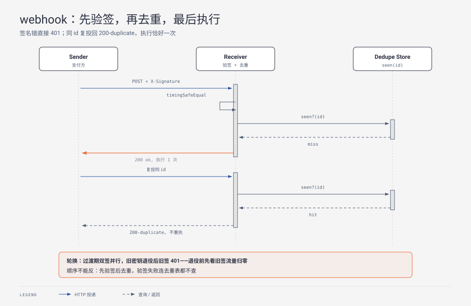

**TL;DR：** 接收第三方 Webhook（如 Stripe、GitHub、支付网关）必须在业务执行前建立严密的防御纵深。首先是防伪与防篡改：服务端必须基于原始字节流（Raw Body）计算 HMAC-SHA256 摘要，并使用常量时间比较函数 `crypto.timingSafeEqual` 消除时序侧信道攻击。其次是防重放与幂等：通过时间戳容忍窗口（5 分钟）拦截过期重放，并在数据库内基于 Event ID 执行原子排重，同 ID 重投返回 HTTP 200 并跳过副作用。最后是零停机密钥轮换：接收端必须支持多活跃密钥列表，在过渡期实现新旧双签并行校验，监控指标归零后再安全下线旧密钥。



## 一、Webhook 接收端的四大安全威胁模型

作为开放给外部互联网的主动回调入口，Webhook 服务面临四类典型的攻击与故障场景。

| 威胁类型 | 攻击或故障表现 | 破防后果 | 体系化防御手段 |
| --- | --- | --- | --- |
| 伪造与冒名 | 攻击者伪造支付成功请求发往网关 | 产生虚假充值与资损 | HMAC-SHA256 共享密钥验签 |
| 报文篡改 | 中途篡改订单金额或收款账号 | 破坏业务数据一致性 | 签名覆盖完整原始 Body 字节流 |
| 时序侧信道 | 统计字符比对耗时逐字节推测签名 | 共享密钥在外部泄露 | `timingSafeEqual` 常量时间比对 |
| 重放与重复 | 抓取合法旧报文重复发送，或网络重试 | 发生重复发货或双重扣款 | 时间戳容忍窗口 + Event ID 去重表 |

## 二、签名校验的密码学与工程细节

签名校验的核心逻辑是验证接收方与发送方共享的密钥签名是否一致。

### 1. 为什么必须使用 Raw Body 原始载荷

最常见的低级漏洞是使用框架解析后的 JSON 对象重新序列化来验签：

```js
// 错误示范：重新序列化后的 JSON 键顺序与空格无法保证与发送方原始报文一致
const badBody = JSON.stringify(req.body);
const badSig = crypto.createHmac("sha256", secret).update(badBody).digest("hex");
```

JSON 规范并未规定对象字段的绝对排序，各语言 JSON 库在空格缩进处理上也存在差异。微小的格式差异会导致哈希值完全改变。
因此，HTTP 中间件必须捕获未经修改的原始 `Buffer` 或字符串字节流进行哈希计算。

### 2. 时序侧信道（Timing Attack）与常量时间比对

传统的字符串比对操作（如 `sig === expected`）通常在发现第一个不匹配的字节时立即短路退出。
攻击者通过高精度统计网络 RTT 与响应微秒差，可以逐位暴力推测出正确的签名字符。
解决方案是使用 Node.js 的 `crypto.timingSafeEqual`。必须先比对长度，只有在长度一致时才执行内存常量时间扫描，防止底层函数抛出异常。

```js
function verifySignature(rawBody, signatureHeader, secret) {
	if (typeof signatureHeader !== "string") return false;
	const expected = crypto.createHmac("sha256", secret).update(rawBody).digest("hex");

	const sigBuf = Buffer.from(signatureHeader);
	const expBuf = Buffer.from(expected);

	if (sigBuf.length !== expBuf.length) return false;
	return crypto.timingSafeEqual(sigBuf, expBuf);
}
```

## 三、双密钥零停机轮换状态机

当共享密钥发生泄露、员工离职或触发定期安全合规策略时，系统需要轮换 Webhook Secret。
发送端与接收端分布在不同的物理网络，绝不可能在同一纳秒完成密钥替换。如果接收端直接硬编码替换单把密钥，在切换过渡期会导致合法的生产回调产生大量 HTTP 401 报错。

### 1. 轮换三步走架构

成熟工程实践采用多密钥滑动窗口模式：

```text
阶段 1 (准备期):
  接收端配置 activeSecrets = [oldSecret, newSecret]
  发送端仍然使用 oldSecret 签名
  接收端优先匹配，两者命中任意一个即放行

阶段 2 (切换期):
  发送端切换为 newSecret 签名
  接收端持续接收，并在指标中记录命中密钥为 "new"
  当监控显示 "old" 命中流量归零时，确认存量积压请求处理完毕

阶段 3 (退役期):
  接收端收窄配置为 activeSecrets = [newSecret]
  旧密钥彻底失效，携带 oldSecret 的残留请求被 401 拦截
```

### 2. 状态机核心实现

以下代码实现了支持双密钥并行的 Webhook 调度器：

```js
import http from "node:http";
import crypto from "node:crypto";

let activeSecrets = [SECRET];

const server = http.createServer(async (req, res) => {
	const send = (code, data) => {
		res.writeHead(code, { "content-type": "application/json" });
		res.end(JSON.stringify(data));
	};

	let rawBody = "";
	for await (const chunk of req) rawBody += chunk;
	const sig = req.headers["x-signature"];

	// 轮换机制：逐个尝试当前有效密钥，避免因格式差异中断
	const matchedSecret = typeof sig === "string"
		? activeSecrets.find((s) => {
			const expected = crypto.createHmac("sha256", s).update(rawBody).digest("hex");
			const a = Buffer.from(sig);
			const b = Buffer.from(expected);
			return a.length === b.length && crypto.timingSafeEqual(a, b);
		})
		: undefined;

	if (!matchedSecret) {
		return send(401, { error: "bad signature" });
	}

	const event = JSON.parse(rawBody);
	if (dedupStore.has(event.id)) {
		// 幂等确认：同 ID 重投返回 200，防止发送方持续重发
		return send(200, { duplicate: true });
	}
	dedupStore.add(event.id);

	return send(200, { ok: true, key: matchedSecret === SECRET ? "old" : "new" });
});
```

## 四、幂等排重与至少一次投递处理

分布式网络中，网络丢包、客户端超时以及反向代理重试使得“恰好一次投递”在物理上无法保证。Webhook 发送方一律遵循“至少一次投递”（At-Least-Once Delivery）合同。

接收端设计必须遵守两项原则：
1. **先防重后执行**：在数据库中建立唯一键约束（`event_id VARCHAR PRIMARY KEY`）。执行任何业务副作用前，先原子插入事件消费记录。若发生主键冲突，说明此前已经成功受理，直接返回 HTTP 200。
2. **复投响应语义清晰**：当检测到重复事件时，必须返回 HTTP 200（并在 Payload 中附带 `duplicate: true` 标记）。严禁返回 4xx 或 5xx，否则上游网关会判定投递失败，触发更剧烈的指数退避重试风暴。

## 五、验证实验与数据闭环

本机制在 `experiments/webhook-hmac/hook.mjs` 中进行了确定性回归测试，8 项用例全部通过：
- H1：合法签名报文正确受理并执行业务（`executions = 1`）。
- H2：同 Event ID 二次投递返回 200-duplicate，执行计数严格保持为 1。
- H3：报文被篡改 1 字节（金额 100 篡改为 999），服务端拦截并返回 401。
- H4：使用错误密钥签名的伪造报文被拦截并返回 401。
- H5 & H5b：在双密钥过渡期内，新旧密钥签发的报文均能正常通过。
- H6 & H6b：旧密钥退役后，旧签签名严格返回 401，新密钥签名持续保持 200 OK。

## 参考资料

- Stripe API Reference: Webhook Signatures (<https://docs.stripe.com/webhooks>)
- GitHub Developer Guide: Securing your webhooks (<https://docs.github.com/en/webhooks/using-webhooks/securing-your-webhooks>)
- Node.js Crypto Documentation: `timingSafeEqual` (<https://nodejs.org/api/crypto.html#cryptotimingsafeequaldigest-signature>)
- 站内对照：API 形状与幂等性工程，`/writing/service-api-shape`
- 架构演进：支付回调系统端到端串联设计，`/writing/service-payment-callback-design`
