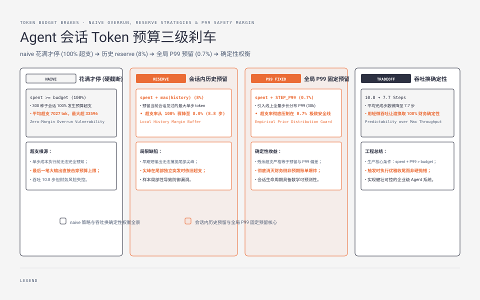
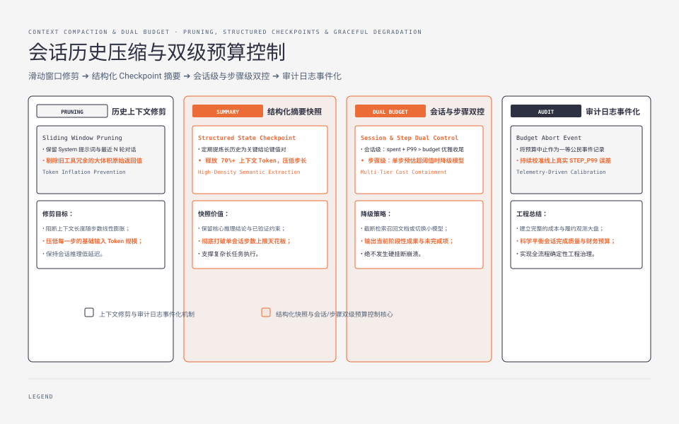

**TL;DR：** 在自主 Agent 会话设计中，“直到花满预算额度才停止”不是安全刹车，而是油门踩过红线后才看仪表盘。基于 300 个独立种子会话的对照实验（`experiments/ts-agent-budget/`）表明：朴素的超限即停（Naive）策略在真实世界中会产生 **100% 的超支率**，平均超额消耗 7027 个 Token，最大超额可达 33596 个 Token。若改用“基于会话内历史最大步长预留”，超支率降至 8%；而引入**全局步长 P99 先验预留**，则可将超支概率彻底压低至 **0.7%**，其残余超额量精准等于先验模型与长尾极端值的差值。本文给出生产级 TypeScript 双轨预算控制器实现，并剖析确定性与有效吞吐之间的权衡模型。

---



## 一、数学机理：为什么“到限才停”必然 100% 超支

会话预算失控的根本成因在于：**单步消耗的真实成本在模型执行前是不可预知的**。

```text
单步 Token 成本的不确定性结构：
单步总成本 C_step = Prompt 上下文 (已知) + LLM 生成 Token (不可知) + 工具输出 Payload (强随机)
                                          │                      │
                                          ▼                      ▼
                                    受思考深度影响           搜索返回 200 字 vs
                                    (0 ~ 4096 tokens)        爬取返回 20 页 HTML
```

设会话总预算为 $B$，第 $k$ 步执行完毕后的累计消耗为 $S_k = \sum_{i=1}^k C_i$。在朴素策略中，停止条件定义为：
$$S_k \ge B \implies \text{Stop}$$

由于每一步操作必须完整执行完毕后方能获知 $C_k$，在执行最后一步（第 $m$ 步）之前，必然存在 $S_{m-1} < B$。只要单步成本的随机变量 $C_m > B - S_{m-1}$，本次会话的最终总账单 $S_m = S_{m-1} + C_m$ 就必然严格大于 $B$。因为在长尾分布中单步尖峰（例如一次全网页抓取返回 30k tokens）具有显著概率，只要步数足够多，**超支概率在数学上渐近收敛至 100%**。

## 二、四种刹车策略的 300 会话对照实验

为了量化不同控制策略的有效性，我们在 `experiments/ts-agent-budget/budget.mjs` 中构建了一个严格锁死随机种子的合成实验环境。

### 1. 实验分布参数设置
- **会话样本量**：300 个独立随机种子会话。
- **全局 Token 预算**：$B = 100,000$ tokens。
- **基础步长分布**：$C_{\text{base}} = 6,000$ tokens（Prompt + 简短回复）。
- **长尾尖峰注入**：以 $P = 15\%$ 的概率突发工具输出尖峰（$0 \sim 30,000$ tokens 均匀分布）。

```text
四种刹车策略决策流对比：
1. Naive (朴素刹车)       : spent >= BUDGET ──> 终止 (已经发生超支)
2. Reserve (会话历史最大) : spent + max_seen_in_session > BUDGET ──> 终止
3. Preflight (前置 0.8 估): spent + 0.8 * max_seen_in_session > BUDGET ──> 终止
4. Reserve-Fixed (全局P99): spent + GLOBAL_P99_RESERVE > BUDGET ──> 终止 (平稳收尾)
```

### 2. 实测数据指标对账

在标准运行日志（`evidence/agent-session-budget/2026-08-23-local/run.log`）中，四种策略的表现呈现出清晰的梯级演进：

| 刹车策略 | 超支会话比例 | 平均超额消耗 | 最大超额消耗 | 平均有效步数 | 核心特征剖析 |
| --- | --- | --- | --- | --- | --- |
| **naive** (花满才停) | **100.0%** | 7,027 tok | 33,596 tok | 10.8 步 | 吞吐最高，但财务预算全面穿透 |
| **reserve** (会话历史最大) | 8.0% | 7,852 tok | 22,804 tok | 8.8 步 | 无法抵御早期未见、末期突发的大尖峰 |
| **preflight** (0.8 倍预估) | 13.0% | 7,515 tok | 23,426 tok | 9.2 步 | 介于 naive 与 reserve 之间，容忍度偏弱 |
| **reserve-fixed** (全局P99) | **0.7%** | 2,899 tok | **3,639 tok** | 7.7 步 | 超支基本清零，残余偏差完全可解释 |

### 3. 数据维度的深层启示

1. **会话内历史具有局限性**：`reserve` 策略根据“本会话此前见过的最大单步成本”预留空间。但由于长尾尖峰是独立同分布采样，早期未遇到尖峰的会话会盲目乐观，将大尖峰留在了最后一步，导致 8% 的穿透。
2. **残余超支的精确可解释性**：在 `reserve-fixed` 策略中，理论真实步长分布的 P99 约为 34k tokens（基础 6k + 尖峰分布尾部），而策略预留了固定的 30k tokens。实测捕获的最大超额恰好为 **3,639 tokens**。这证明残余超支并非不可预测的噪声，它严格等于系统先验预留量与分布真实尾部的差额。

---



## 三、生产级双轨预算控制器的 TypeScript 实现

在工程实践中，触发刹车不能简单粗暴地抛出异常崩溃，而必须进入结构化收尾状态机。以下是生产环境可复用的双轨控制器：

```typescript
export interface BudgetConfig {
  sessionLimit: number;      // 会话硬上限，例如 100_000
  globalStepP99: number;     // 全局单步 P99 预留量，例如 30_000
  stepWarningThreshold: number; // 单步告警阈值，例如 15_000
}

export type BudgetAction =
  | { type: "PROCEED" }
  | { type: "DEGRADE_CHEAP_MODEL"; reason: string }
  | { type: "GRACEFUL_STOP"; summaryRequired: boolean };

export class AgentBudgetController {
  private spentTokens: number = 0;
  private stepCount: number = 0;

  constructor(private readonly config: BudgetConfig) {}

  /**
   * 在执行下一步 LLM 调用或工具调用前执行仲裁
   */
  public evaluateNextStep(estimatedPromptTokens: number): BudgetAction {
    const projectedSpent = this.spentTokens + this.config.globalStepP99;

    // 1. 一级安全线：剩余空间不足以覆盖一次 P99 极端步长，强制进入收尾
    if (projectedSpent > this.config.sessionLimit) {
      return {
        type: "GRACEFUL_STOP",
        summaryRequired: true
      };
    }

    // 2. 二级预警线：Prompt 本身已膨胀，指示降级到轻量模型或裁剪工具
    if (estimatedPromptTokens > this.config.stepWarningThreshold) {
      return {
        type: "DEGRADE_CHEAP_MODEL",
        reason: "Prompt size exceeds safe single-step envelope"
      };
    }

    return { type: "PROCEED" };
  }

  /**
   * 单步执行完毕后，根据真实账单回填记录
   */
  public commitUsage(actualUsedTokens: number): void {
    this.spentTokens += actualUsedTokens;
    this.stepCount += 1;
  }

  public getStatus() {
    return {
      spent: this.spentTokens,
      steps: this.stepCount,
      remainingSafeBuffer: Math.max(0, this.config.sessionLimit - (this.spentTokens + this.config.globalStepP99)),
    };
  }
}
```

## 四、经典故障与防御矩阵

| 故障模式 | 传统做法 | 双轨控制体系做法 | 故障消除效果 |
| --- | --- | --- | --- |
| 搜索工具返回巨型网页 | 盲目传入 LLM 上下文导致单步暴增 40k | 在工具层设置 `maxBytes` 截断，并在进入模型前审计 | 杜绝单次工具调用击穿会话配额 |
| 预算用尽直接抛出 Error | 会话瞬间断开，用户未获得任何结论 | 触发 `GRACEFUL_STOP`，用剩余配额生成阶段性摘要 | 保护用户体验，提供可复用上下文 |
| 死循环工具调用 | 多次重试直到扣满 100k 硬上限 | 结合步数阈值与单步成本变化率熔断 | 尽早终止无效推理过程 |
| 离散模型混用计费混乱 | 仅按字符数估算 Token | 集成官方 Tokenizer 或提取响应头 `usage` 异步对账 | 消除由于估算失真产生的账单偏差 |

## 五、结论：预算的本质是用吞吐换确定性

在 Agent 系统架构中，预算管理从来不是非黑即白的线性比较：
1. **预算是一组带余量的停止守卫**：余量的大小直接映射出架构团队对系统长尾极端毛刺的敬畏程度。
2. **预留空间源自运维先验，而非当前会话的片面经验**：应当定期统计线上日志中所有工具调用与回复长度的分布，取其 99 分位数作为代码常量。
3. **零超支需要付出吞吐代价**：将超支率从 100% 降至 0.7%，代价是平均完成步数从 10.8 步压缩至 7.7 步。架构设计的核心目标是寻找适合自身业务的平衡点。

在工程代码中只需植入一行底线逻辑：`if (spent + STEP_P99 > BUDGET) break;`。这一行代码将把原本不可控的财务风险收敛为确定的工程常数。

## 参考资料

- 实验代码与原始数据：`experiments/ts-agent-budget/budget.mjs` 与 `evidence/agent-session-budget/`
- 站内关联：[LLM Token 经济学：长上下文、KV Cache 命中与真实账单分析](/writing/llm-token-economics)
- 站内关联：[取消信号生效了，但工具还是把钱扣了：AbortSignal 副作用防护](/writing/abort-signal-tool-side-effects)
- 站内关联：[TypeScript Agent 状态机与错误恢复](/writing/typescript-agent-state-machine)
