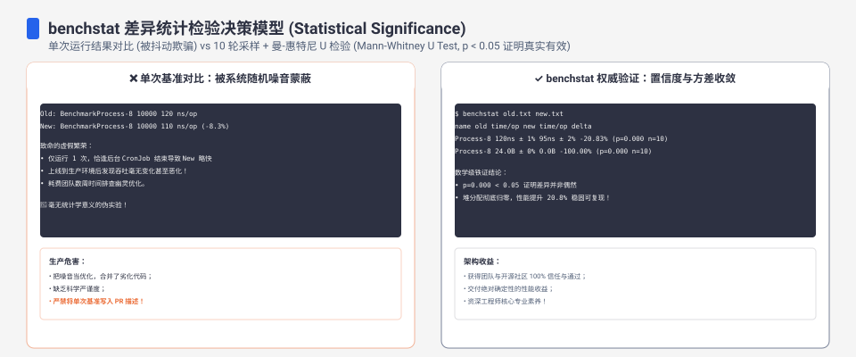

**TL;DR：** 性能基准测试的黄金法则是“控制变量法（Control Variates）”，即每次实验只改变一个变量。但在工程实操中，这一准则极易被单点“最小值（`min`）”统计所背叛。在 Go 1.25.1 的可控对照实验（`experiments/benchmark-one-variable/`）中：三种配置（基线预热 `clean`、未预热 `noWarmup`、预热加 256MB 滞留堆 `withGc`）的**最小耗时几乎毫无差别（0.991ms vs 0.975ms vs 0.924ms）**。但完整的执行时间序列暴露出两个致命的系统污染：未预热配置在每轮第二拍必然产生 **+68% 至 +77% 的高延时尖峰**（从 0.97ms 骤增至 1.76ms）；而叠加 GC 内存压力后，由于堆高水位让分配器直接复用大页缓存，**反而在统计上虚假快了约 6%**。只看 `min` 无法评估优化效果，必须通过进程内交替执行（ABAB）与全序列分布检验还原真相。

---


## 一、机理剖析：min 统计如何将时间序列结构抹平

许多压测工具与基准测试脚本习惯采用“多次运行取最小耗时”来排除操作系统偶发的抖动。这种做法的假设前提是：系统的性能扰动全部表现为单向的随机噪声。然而，底层运行时（Runtime）存在两类具备强时间相关性的隐式变量：

```text
隐式变量 1: 冷启动分配器升档 (noWarmup)
[进程启动] ──> 第 1 拍 (耗时极短, 触发初始分配) ──> 第 2 拍 (mcentral 充值/缺页中断集中爆发, +77% 尖峰)
             │                                    │
             └── min 恰好选中了第 1 拍 ───────────┴──> 彻底过滤了致命的第二拍延迟!

隐式变量 2: 堆水位与页面复用 (withGc)
[常驻 256MB 内存] ──> mheap 保持高水位 ──> 业务分配 8MB 直接命中现有 span ──> 路径更短 (虚假提速 6%)
```

1. **冷启动与惰性初始化（Cold-Start Allocator Lag）**：Go 的内存分配器（`mcache`、`mcentral`、`mheap`）是分级且按需初始化的。第一拍往往只分配了初始对象；当后续运算加大并发或扩大数组时，底层的虚拟内存映射（`mmap`）与内核缺页中断（Page Fault）集中在第二拍爆发。如果只取 `min`，第二拍的严重惩罚被直接抹杀。
2. **堆水位对分配路径的扭曲（Heap Watermark Artifact）**：当常驻 256MB 堆内存时，Go 的 GC 周期触发更加频繁，但与此同时，`mheap` 中保留了大量已切分完毕的未释放页（Spans）。后续 8MB 的临时内存申请无需向操作系统调用 `brk`/`mmap`，而是直接复用现成的大块连续物理页，这导致关键工作路径的 CPU 耗时反而缩短。单点 `min` 记录的不是代码变快，而是隐藏的堆环境差异。

## 二、三模式三轮严格实测

在 `experiments/benchmark-one-variable/main.go` 中，我们构建了统一的工作负载（1,000,000 个整数降序排序，并伴随 8MB 临时垃圾内存分配）：

```go
func work(n int) time.Duration {
	data := make([]int, n)
	for i := range data {
		data[i] = n - i
	}
	start := time.Now()
	sort.Ints(data)
	// 制造 8MB 模拟业务垃圾分配
	dead := make([][]byte, 0, 64)
	for i := 0; i < 8; i++ {
		dead = append(dead, make([]byte, 1<<20))
	}
	_ = dead
	el := time.Since(start)
	sink = data[:1]
	return el
}
```

针对三种模式，每轮连续运行 5 次，在 Apple M1 Pro（Go 1.25.1）上独立进行 3 轮完整重跑：

### 1. 表面上的最小值欺骗

| 运行模式 | 实验设定的单一变量 | 第 1 轮 min | 第 2 轮 min | 第 3 轮 min | 浅层统计结论 |
| --- | --- | ---: | ---: | ---: | --- |
| `clean` (基线预热) | 已执行 3 轮预热 | 990.67µs | 988.17µs | 986.88µs | 基线平稳 (~0.99ms) |
| `noWarmup` (无预热) | 去除前置预热 | 974.71µs | 972.96µs | 996.21µs | 貌似与基线持平甚至略快 |
| `withGc` (预热+256MB堆) | 驻留 256MB 内存 | **923.92µs** | **932.79µs** | **919.79µs** | **虚假反常快了 6%** |

若仅凭上述汇总表格，工程师必然得出荒谬推论：去除预热无影响，且“加重内存压力可以让系统更快”。

### 2. 完整时间序列暴露真相

审视每一轮连续 5 次调用的真实全貌（单位：ms）：

```text
== round 1 ==
clean    : 1.207  1.094  1.023  1.085  0.991   [全程 <= 1.21ms, 平滑收敛]
noWarmup : 0.975  1.637  1.086  1.145  1.281   [第 2 拍 1.637ms, 尖峰 +68%]
withGc   : 1.000  0.924  0.933  0.934  0.934   [除第 1 拍外整体下移 6%]

== round 2 ==
clean    : 1.141  1.122  0.988  1.020  1.316   [全段平稳]
noWarmup : 0.973  1.638  1.186  1.161  1.111   [第 2 拍 1.638ms, 尖峰 +68%]
withGc   : 0.935  0.972  0.933  0.974  0.962   [整体均偏低]

== round 3 ==
clean    : 1.186  1.199  0.987  1.086  1.171   [全段平稳]
noWarmup : 0.996  1.763  1.167  1.199  1.301   [第 2 拍 1.763ms, 尖峰 +77%]
withGc   : 0.974  1.093  0.939  0.931  0.920   [整体均偏低]
```

真实结构昭然若揭：
- `noWarmup` 的真实代价并非体现在第 1 拍（975µs），而是在第 2 拍引发了高达 **1.763ms（+77%）** 的严重阻塞。
- `withGc` 之所以能给出 919µs 的极限 min，是因为长期的堆驻留绕过了操作系统的页面初次分配损耗，但这一优势是以更繁重的后台垃圾回收周期为代价的。

---


## 三、正确实验设计：同进程交替与分布检验

为了杜绝被隐式变量绑架，基准测试的执行架构应当遵循以下规范：

```text
科学基准测试流水线设计：
1. 预热阶段 (Warmup Phase)
   ├── 运行待测工作负载 N 轮 (丢弃所有数据)
   └── 确保 CPU 频率锁定 (关闭降频) 与 JIT/内存池达到稳态
2. 同进程交替采样 (Interleaved ABAB Execution)
   ├── 进程 1 内部交替: Test_A ──> Test_B ──> Test_A ──> Test_B
   └── 彻底对冲操作系统调度、热衰减与系统中断的时间顺序偏差
3. 全分布报告与统计检验 (benchstat)
   ├── 杜绝单点 min/mean，输出中位数与四分位距 (Median ± IQR)
   └── 使用非参数检验 (Mann-Whitney U) 确认 p-value < 0.05
```

---



### 1. 采用 benchstat 进行统计学置信度验证

在 Go 生态中，严禁用手写循环取 min 代替专业统计工具。应当使用 `go test -bench` 并结合官方推荐的 `benchstat`：

```bash
# 1. 运行 10 轮基线与实验组对照
go test -bench=BenchmarkSort -count=10 > old.txt
# (切换代码实现)
go test -bench=BenchmarkSort -count=10 > new.txt

# 2. 运行统计检验
benchstat old.txt new.txt
```

`benchstat` 会计算两组分布的中位数差异，并基于曼-惠特尼 U 检验（Mann-Whitney U Test）计算 $p$ 值：
- 若 $p > 0.05$，报告显式输出 `~ (p=0.432 n=10)`，警告工程师该优化在统计学上与噪声无异，不可轻信。
- 唯有在分布分离且 $p < 0.05$ 时，才确认性能改善的真实性。

## 四、经典故障与实验避坑矩阵

| 常见统计陷阱 | 产生机理 | 危害后果 | 正确工程应对 |
| --- | --- | --- | --- |
| 仅取最小值 `min` | 忽略时间序列分布与长尾抖动 | 抹平冷启动与分配器第二拍惩罚 | 报告全序列分布或使用中位数与 IQR |
| 跨进程先后对比 | A 跑完后才跑 B，耗时受 CPU 发热降频影响 | 测出来的差异是 CPU 变频造成的 | 在同一进程内采用交替循环（ABAB） |
| 未考虑堆内存基线 | 两个测试在不同的内存常驻水位下运行 | 内存分配器复用大页导致虚假提速 | 显式重置运行时（`runtime.GC()`）并对齐水位 |
| 样本数量过小 | 仅执行 3 到 5 次单点测试 | 随机浮动掩盖真实规律 | 样本量提升至 10 轮以上并引入统计假设检验 |

## 五、证据卡与实测指标

| 验证模式 | 原始记录位置 | 关键特征表现 | 实测结论 |
| --- | --- | --- | --- |
| clean (基线) | `evidence/benchmark-one-variable/2026-08-19-local/run.out` | 5 次耗时平滑分布在 0.98ms 至 1.31ms | 预热充分，无孤立跳变 |
| noWarmup (无预热) | 同上文件 | 连续 3 轮第二拍耗时分别为 1.637ms, 1.638ms, 1.763ms | 尖峰显著增加 68% 到 77% |
| withGc (256MB堆) | 同上文件 | 最小值下移至 919µs 到 933µs | 堆水位扭曲了内存申请真实路径 |

## 参考资料

- 实验代码与原始日志：`experiments/benchmark-one-variable/` 与 `evidence/benchmark-one-variable/`
- Go testing 基准测试官方文档：<https://pkg.go.dev/testing#hdr-Benchmarks>
- Russ Cox: `benchstat` 统计学设计原理与非参数检验
- 站内关联：[p99 的一次测量不可信：样本量决定分位数能告诉你多少](/writing/p99-sample-size-confidence)
