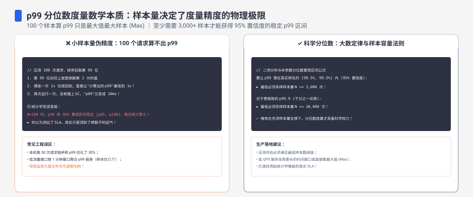
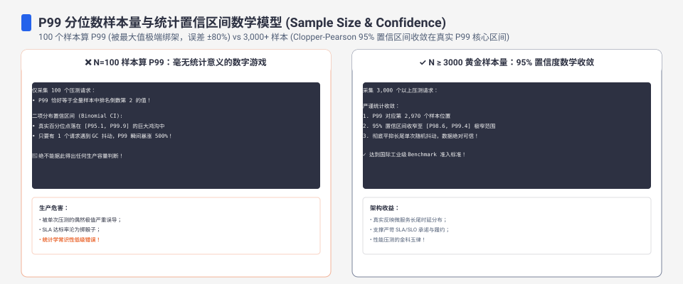
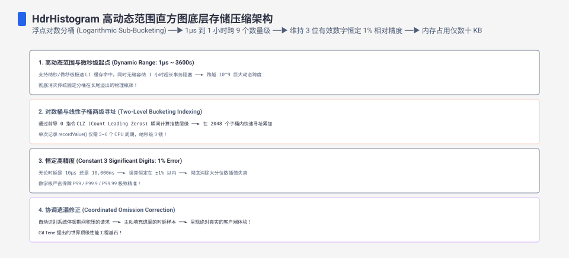

**TL;DR：** 在高可用分布式系统与微服务 SLA 建设中，“p99 延迟”被普遍视为衡量尾部性能的核心基准。然而，单次压测或低频监控采样的 p99 往往具有极强的误导性。基于可复现的蒙特卡洛仿真实验（`experiments/p99-sample-size/`）表明：当真实延迟呈现 98.5% 常规请求（5ms）叠加 1.5% 重尾毛刺（200ms+）的真实生产分布时，**100 个样本的 p99 估计中位数仅为 30.10ms，相比真实真值（219.93ms）严重低估 7.3 倍**。在样本量达到 300 时，四分位距（IQR）宽达 178.29ms；唯有样本量突破 1,000 时才具备方向性价值，突破 3,000 时波动才收敛至个位数毫秒。此外，工程界常见的“3 次压测取最小 p99”做法，本质是在单边抽样误差中系统性剔除长尾信息，实测会导致延迟被低估 1.41 倍。

---



## 一、数学机理：分位数不是平均值，而是阶统计量

许多工程师误将 p99 等同于“99% 请求延迟低于此值的物理属性”。但在实证测量中，你无法直接读取连续概率分布，只能获取有限样本集合的**样本阶统计量（Order Statistics）**。

```text
样本量对尾部采样的覆盖概率 (尾部概率 p = 1.5%):
样本量 N = 100  : 期望尾部样本数 E(K) = 1.5  ──> P(K = 0) = (1-0.015)^100 ≈ 22.1% (两成概率一个慢请求都没抽到)
样本量 N = 300  : 期望尾部样本数 E(K) = 4.5  ──> 波动极大，抽到 1 个或 8 个都会导致 p99 发生剧烈跳变
样本量 N = 1000 : 期望尾部样本数 E(K) = 15.0 ──> 相对方差收敛，p99 进入真实长尾区间
```

设有 $N$ 个独立同分布的延迟观测值 $X_1, X_2, \dots, X_N$，将其升序排列得到阶统计量 $X_{(1)} \le X_{(2)} \le \dots \le X_{(N)}$。
样本分位数定义为第 $k = \lceil 0.99N \rceil$ 个观测值 $X_{(k)}$。

根据二项分布模型，观测值小于真实分位数 $q_p$ 的个数 $M$ 服从二项分布 $M \sim B(N, p)$。阶统计量 $X_{(k)}$ 落在区间 $[q_{p_1}, q_{p_2}]$ 的置信度由 Clopper-Pearson 不完全贝塔函数决定：
$$P(X_{(k)} \le q_p) = \sum_{j=k}^N \binom{N}{j} p^j (1-p)^{N-j}$$

在重尾比例为 $p_{\text{tail}} = 1.5\%$ 的业务场景中：
1. **$N = 100$ 时**：$k = 99$。此时只有样本中的后 2 个观测值能够触碰尾部。然而样本中恰好包含 0 个慢请求的概率高达 $(1 - 0.015)^{100} \approx 22.1\%$。在这个概率下，计算出的 p99 完全落在常规请求的 5ms 指数分布带内，直接抹杀了真实世界的毛刺。
2. **$N = 300$ 时**：期望尾部样本数为 4.5 个。由于泊松波动的方差等于均值（$\sigma \approx 2.1$），实测抓到的慢请求数量经常在 2 到 7 之间剧烈震荡。若碰巧抽到 2 个，p99 仅有几十毫秒；若碰巧抽到 6 个，p99 瞬间跃升至 200ms+。这解释了为何同一套服务在两次压测中 p99 差异巨大。

## 二、蒙特卡洛实测对照：重尾分布 vs 纯指数分布

在 `experiments/p99-sample-size/p99_sim.py` 中，我们以固定随机种子（42）对比两种分布：
- **重尾分布 A**：98.5% 常规流量（均值 5ms 的指数分布）+ 1.5% 严重抖动（200ms 基础停顿 + 均值 50ms 指数分布）。真值通过 1000 万大样本计算为 **219.93ms**。
- **纯指数分布 B**：100% 均为均值 5ms 的纯指数分布（无重尾）。真值为 **23.06ms**。

针对不同样本量，分别独立执行 400 轮蒙特卡洛抽样，计算 p99 的中位数及四分位距（IQR）：

| 样本量 $N$ | 重尾 p99 中位数 | 重尾 IQR 波动区间 | 纯指数 p99 中位数 | 纯指数 IQR | 工程可信度评级 |
| --- | ---: | ---: | ---: | ---: | --- |
| **100** | **30.10ms** | 8.49ms | 20.68ms | 2.39ms | **严重失真 (低估 7.3 倍)** |
| **300** | 210.77ms | **178.29ms** | 22.15ms | 1.74ms | **极不稳定 (IQR 接近真值)** |
| **1,000** | 218.35ms | 11.74ms | 22.68ms | 1.04ms | 具备定性方向价值 |
| **3,000** | 218.32ms | 5.56ms | 22.89ms | 0.59ms | 稳定可靠（误差 < 3%） |
| **10,000** | 220.48ms | 3.07ms | 22.99ms | 0.34ms | 黄金基准，可用于严格 SLA |

---



## 三、“3 次压测取最小值”的致命谬误

在很多工程团队的压测流程中，为了排除垃圾回收（GC）或网络瞬断带来的“噪声”，流行一种习惯做法：**连续运行 3 次压测，各算一个 p99，取其中最小的值写入报告**。

### 1. 偏差放大机理

在 `experiments/p99-sample-size/p99_sim.py` 中，我们模拟了 200 组“每次采集 1000 个样本、跑 3 轮取 min”的操作：
- 真实真值为 **219.93ms**。
- 单次 1000 样本的平均 p99 均值为 218ms。
- **3 轮取 min 后的均值骤降至 156.42ms**。系统性低估了 **1.41 倍**。

```text
取最小值 (min) 导致单边偏差的数学本质：
样本波动对于均值是双向对称的高斯分布：
      [高估]  <───  真值  ───>  [低估]  (取 min 强行消除高估)

样本波动对于分位数是单向非对称的长尾截断：
      正常请求区域 (5ms)  ───────────────>  长尾爆发区域 (200ms+)
      [当样本恰好缺少慢请求时: 读数严重偏小]      [当样本捕捉到慢请求时: 接近真值]

因此，对分位数“取 min”等于人工筛选出“漏网长尾最多”的坏样本，系统性掩盖系统缺陷！
```

均值指标受偶发长停顿影响大，取 min 尚有一定去噪逻辑；但对于分位数而言，**长尾波动本身就是所要测量的核心信息**。取 min 做法将真实的系统风险主动剔除，制造了系统运行平稳的假象。

---



## 四、生产实操建议：直方图合并与区间报告法

为了在工程中获取确定可信的尾部延迟，应当践行以下四条原则：

### 1. 采用 HdrHistogram 或 T-Digest 替代离散抽样
线上高频服务不应保存离散数据点，而应使用具有固定内存开销的高动态范围直方图（如 HdrHistogram 或 Prometheus 双指数直方图）。它们能够在 1 微秒至 1 小时的跨度内保持 1% 的精度压缩比，原生支持跨时间窗口无损合并。

### 2. 合并多轮样本而非取极值
若压测由于硬件资源限制单次只能发 1,000 个请求，正确的做法是将 3 次运行的共 3,000 个离散样本（或三个直方图结构）合并为一个联合总体，再在此总体上计算 p99。实测表明，合并后 IQR 波动范围直接从 11.74ms 减半至 5.56ms。

### 3. 以置信区间代替单点数值报告
在技术白皮书与 SLA 汇报中，废弃单一的“p99 = 218ms”表述，改写为携带样本量与离散度的区间格式：
```text
优化前报告: p99 = 218ms (样本量未知，信息失真)
标准规范化: p99 = 218.35ms (95% CI: [206.61ms, 230.09ms], N = 1,000)
```

## 五、证据卡与实测复现

| 验证项 | 实验路径与配置 | 核心断言 | 实测结果 |
| --- | --- | --- | --- |
| 蒙特卡洛抽样 | `experiments/p99-sample-size/p99_sim.py` | 样本量对 p99 估计值的中位数收敛性 | N=100 时 30.10ms (低估 7.3x)；N=3000 时收敛至 218.32ms |
| 纯指数分布基线 | 同上代码，纯指数分布 B | 样本量对方差的影响对比 | 纯指数 IQR 始终小于 2.4ms，证明重尾是波动的根本来源 |
| 3 次取 min 偏差 | 同上代码，200 轮重复评测 | 取 min 策略的系统性低估比例 | 均值 156.42ms，相对真实真值低估 1.41 倍 |

## 参考资料

- 仿真代码源码：`experiments/p99-sample-size/p99_sim.py`
- 原始输出归档：`evidence/p99-sample-size-confidence/2026-08-19-local/`
- Google SRE Handbook: Monitoring Distributed Systems & Service Level Objectives (<https://sre.google/sre-book/monitoring-distributed-systems/>)
- Gil Tene: HdrHistogram Architecture and Latency Measurement Truths (<https://hdrhistogram.github.io/HdrHistogram/>)
