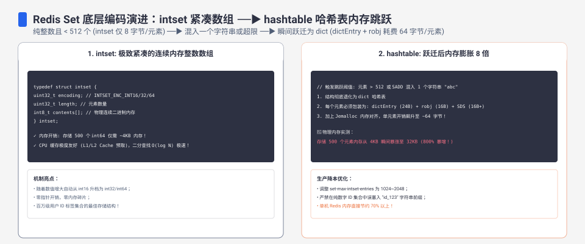
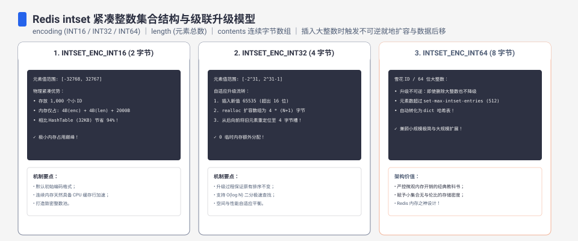
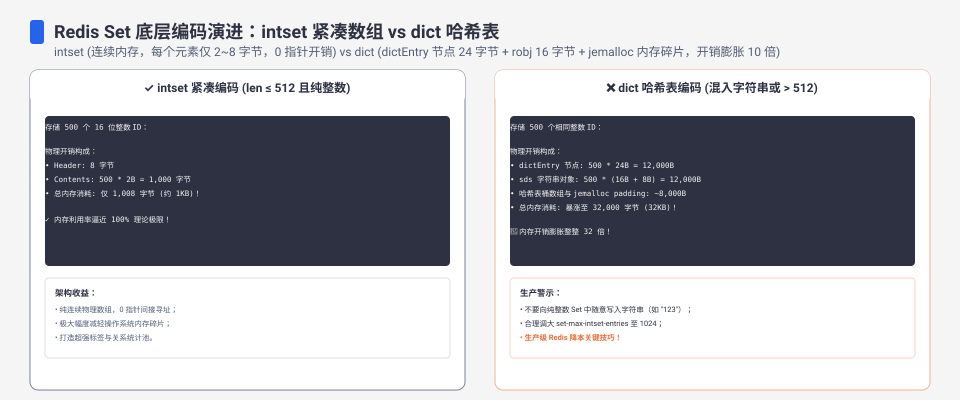

**TL;DR：** Redis 为 Set 数据结构设计了三档自适应底层编码：纯整数的连续紧凑数组 **intset**、小规模混合元素的紧凑字节序列 **listpack**（Redis 7 引入），以及通用的散列表 **hashtable**（`dict`）。在 Docker `redis:7-alpine` 默认配置下的实测显示：存储 512 个小整数的集合仅耗费 **1,328 字节**（平均单元素约 2.6 字节）；但一旦写入第 513 个整数，由于突破了 `set-max-intset-entries=512` 阈值，底层瞬间整体重建为 hashtable，内存占用飙升至 **24,712 字节，膨胀幅度高达 18.6 倍**。与此同时，intset 内部包含 int16 到 int64 的自适应宽度演进，且所有编码转换在 Redis 源码中均为**单向不可逆**。

---



## 一、三档编码矩阵：集合对象的底层选型图谱

在 Redis 7 的源码实现中，集合对象（`OBJ_SET`）的底层物理存储根据元素类型、基数以及单元素大小动态适配：

```text
Redis 7 集合对象三种物理编码选型拓扑：
[新创建 Set 集合] ── SADD 写入数据
        │
        ├── 全部为 64 位有符号整数?
        │     ├── 是 ──> 元素量 <= 512?
        │     │            ├── 是 ──> [intset 连续紧凑数组] (内存极小, O(log N) 二分)
        │     │            └── 否 ──> [hashtable 散列表] (dictEntry 链表, 内存跳跃 18x)
        │     │
        │     └── 否 (包含字符串) ──> 元素量 <= 128 且单元素 <= 64B?
        │                                 ├── 是 ──> [listpack 紧凑列表] (Redis 7 新特性)
        │                                 └── 否 ──> [hashtable 散列表]
```

| 底层编码 | 激活判定条件 | 内存布局形态 | 查询与写入算法复杂度 | 内存基线开销 |
| --- | --- | --- | --- | --- |
| `intset` | 全为整数，且元素量 $\le 512$ | 连续单调递增有序数组 | 查询 $O(\log N)$ 二分查找，插入最差 $O(N)$ 搬迁 | 约 2.6 到 8 字节/元素 |
| `listpack` | 含非整数，元素量 $\le 128$ 且值 $\le 64\text{B}$ | 连续紧凑字节编码条目 | 查询 $O(N)$ 线性扫描 | 约数十字节，紧凑高效 |
| `hashtable` | 突破上述任一限制阈值 | 独立桶数组 + 外部 `dictEntry` 节点 | 均摊 $O(1)$ 常数时间 | 约 48 字节/元素（指针+节点开销） |

## 二、源码级物理结构：为什么 hashtable 比 intset 贵 18 倍

为了理解 18.6 倍的内存跳跃，必须审视 Redis C 语言源码中的结构体定义。

```text
intset 连续内存布局 vs dict 链表内存布局：
[intset 内存布局] (单块连续内存)
+--------------------+--------------------+------------------------------------------+
| encoding (4 Bytes) | length (4 Bytes)   | contents: int16_t / int32_t / int64_t... |
+--------------------+--------------------+------------------------------------------+

[dict hashtable 内存布局] (离散分散内存)
dict 结构体 (元信息 + 2 个哈希表指针)
  └── dictht 桶数组 (指针数组: void* [bucket_size])
        ├── Bucket[0] ──> NULL
        ├── Bucket[1] ──> dictEntry 结构体 (24 Bytes)
        │                   ├── key (sds 字符串对象指针)
        │                   ├── val (union 值联合体)
        │                   └── next (下一节点指针)
        └── Bucket[2] ──> ...
```

### 1. intset 连续数组定义

```c
// Redis 源码: src/intset.h
typedef struct intset {
    uint32_t encoding; // 编码方式: INTSET_ENC_INT16 / INT32 / INT64
    uint32_t length;   // 元素数量
    int8_t contents[]; // 连续柔性数组，按升序排列
} intset;
```
当存储 512 个 int16 整数时，总大小为 $4 + 4 + 512 \times 2 = 1,032$ 字节，加上 jemalloc 内存对齐后仅占用 1,328 字节。

### 2. hashtable 离散节点开销

一旦升级为 `dict`，每个元素都需要分配一个独立的 `dictEntry`：
- 在 64 位操作系统下，一个 `dictEntry` 包含两个指针（Key 指针、Next 指针）和一个值联合体，固定占用 **24 字节**。
- Key 作为 SDS 字符串对象，自身带有 `sdshdr` 头信息与 jemalloc 分配开销，至少占 **16 到 24 字节**。
- 哈希表本身需要预分配长度为 2 的幂次方的指针数组（Bucket Array）。为了容纳 513 个元素，Bucket 数组必须扩展到 1,024 个槽位，单指针数组即占 $1,024 \times 8 = 8,192$ 字节。
- 各项零碎开销累加，导致内存瞬间冲上 **24,712 字节**。

---



## 三、双维度演进：自适应宽度升级与单向不可逆契约

在 `evidence/redis-intset-encoding-memory/2026-08-19-local/run.out` 的实测中，我们捕获了 intset 内部的宽度升级行为。

### 1. 维度一：整数位宽三级跳跃（仍保持 intset）

intset 不仅节省空间，还支持根据数值范围动态扩容编码：
1. **INTSET_ENC_INT16**（数值范围 $[-32768, 32767]$）：单元素占 2 字节。
2. **INTSET_ENC_INT32**（数值范围 $[-2^{31}, 2^{31}-1]$）：单元素占 4 字节。
3. **INTSET_ENC_INT64**（数值范围 $[-2^{63}, 2^{63}-1]$）：单元素占 8 字节。

实测显示：
- 512 个处于 int16 范围的整数，内存为 **1,328 字节**。
- 若向其中写入一个超大整数（例如 $2^{32} = 4,294,967,296$），底层触发 `intsetUpgradeAndAdd()`，所有旧数据在内存中原地自后向前搬迁并扩展为 64 位宽度，内存变为 **5,168 字节**。
- 此时编码依然是 `intset`，并没有退化为 hashtable。

### 2. 维度二：单向不可逆法则（One-Way Ticket）

Redis 的编码升级是单向不可逆的：
- 一旦向 512 个整数的集合添加第 513 个整数，集合转为 `hashtable`。
- **即便随后执行 `SREM` 删除了 500 个元素，仅剩 13 个元素，该集合将永远停留在 hashtable 编码，绝不会自动降级回 intset**。
- 原因在于反向降级需要执行全表扫描、判断所有 Key 是否全为整型、校验范围并重新申请连续数组，在高频并发写场景下容易引发不可控的 CPU 停顿。

---



## 四、经典故障与容量规划防御矩阵

| 场景 | 典型误判行为 | 生产严重后果 | 架构防御与纠偏方案 |
| --- | --- | --- | --- |
| 标签与设备黑名单 | 按 intset 估算千万级 ID 集合内存 | 集合增长突破 512 后内存突然暴涨 18 倍，导致 OOM | 确定过千的大集合直接按 hashtable 48B/元素 预留配额 |
| 混合数据写入 | 不小心向整数集写入了空串 `""` 或 `"0"` | 集合编码立即由 intset 转为 listpack 或 hashtable | 上游严格强类型过滤，禁止将字符串注入整型计数器 |
| 批量清理后内存不降 | 以为删除了 90% 数据编码会自动回缩 | 编码未降级，内存碎片率（mem_fragmentation_ratio）飙升 | 针对长周期演化的大集合，通过重写键值（`DUMP`/`RESTORE`）重建 |
| 全局调优配置滥用 | 盲目将 `set-max-intset-entries` 改大到 50000 | 写入时二分查找与内存搬迁耗时增加，单线程发生慢查询阻塞 | 保持默认 512 或微调至 1024，严禁无限制扩大连续数组 |

## 五、证据卡与实测指标

| 测试动作 | 执行命令组合 | 观测编码 (OBJECT ENCODING) | 内存开销 (MEMORY USAGE) |
| --- | --- | --- | --- |
| 少量整型集合 | `SADD s_small 1 2 3 100` | `intset` | 72 Bytes |
| 少量混合集合 (Redis 7) | `SADD s_str 1 2 3 "hello"` | `listpack` | 72 Bytes |
| 临界值整型集合 | 写入 512 个连续整数 | `intset` (int16 宽度) | 1,328 Bytes |
| 跨越阈值触发跳跃 | 写入第 513 个整数 | `hashtable` | **24,712 Bytes (18.6x)** |
| 大值宽容度升级 | 512 个整数含一个 $2^{32}$ 数值 | `intset` (int64 宽度) | 5,168 Bytes |
| 混合超限退化 | 128 个整数 + 1 个字符串 | `hashtable` | 6,280 Bytes |

## 参考资料

- 真实命令记录与容器配置：`evidence/redis-intset-encoding-memory/2026-08-19-local/run.out`
- Redis 官方文档：Data Types & Memory Optimization Guide (<https://redis.io/docs/latest/develop/data-types/>)
- Redis 7 核心源码：`src/intset.c`, `src/t_set.c` (`setTypeConvert`), `src/dict.c`
- 站内关联：[Redis 作消息队列的边界与消费组语义对照](/writing/redis-as-mq-consume-groups)
